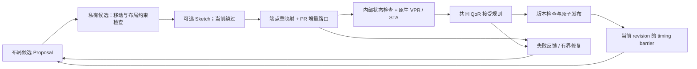

# FusionPAR 框架接口与上游接入边界

本文描述当前可执行的 CPU 框架，接口以
[`joint_state.hpp`](../include/joint_state.hpp) 为准。TP、RC 的研究算法可以分别
替换候选生成和预测检查；PR 已通过 production HBM C-model 接入。输入必须
已有合法布局和路由，目前不负责从 packing 后输入生成第一份合法解。

任何阶段拒绝都不发布私有候选。图中的修复重新生成 Proposal，并消耗相应模式
定义的预算；不会在失败候选上直接修改 authoritative state。

## 上游责任与当前实现

| 上游/职责 | 当前接入点 | 接入时必须保持的语义 |
|---|---|---|
| TP 候选生成 | `Proposal` / `Move`；host 当前调用 `propose_moves` | 每个移动提供实例、旧位置、新位置和观察到的 placement version；不能提前修改 Engine 的状态 |
| RC 预测 | `Sketch` 回调 | 可以否决候选；不能以预测结果替代真实路由、合法性或 STA |
| PR 路由 | `Router(RoutingRequest) -> RoutingReply` | 返回每个请求连接的完整路径及稳定身份；遵守共享 net 的占用与分支保留契约 |
| 原生合法性 | `Validator` 回调与 `validate_candidate.py` | 只验证候选并归档，不修改已发布状态；失败则拒绝发布 |
| 接受目标 | `Acceptance` 回调 | 在候选通过合法性检查后决定是否接受；研究模式使用共同 native WL/CPD 规则 |
| 布局修复 | `propose_repairs` 与 host 的失败反馈调度 | 只处理失败证据涉及的移动实例，遵守位移半径、去重和预算 |
| 主机时序 | `Engine::timing_barrier` | 提交完整连接 criticality 数组，绑定当前 revision；不得使用旧状态的时序快照 |

TP 的数据边界已经明确，但默认 host 尚未提供动态加载 placer 的插件机制。
接入高级 TP 候选策略仍需替换 host 的生成调用，并重新冻结和测试控制策略。
同样，RC 回调入口存在，但开发与独立验证协议都绕过 sketch，不能宣称已经
验证 RC 预测器。DR 多 die 协调不属于这一版核心闭环。

## 调用阶段与状态含义

`Engine::prepare` 复制已发布状态，在私有副本中应用移动并检查 placement 约束。
**Sketch 被调用时，新 placement 已生效，但 route 仍是旧路径。** RC 应把它
理解为路由前预测输入；不能把旧端点路径当成新布局的合法路由，也不能在此处
要求整个候选通过布线一致性检查。

随后 Engine 根据受影响实例找出受影响 net，并重新映射 source/sink。当前以
net 为释放单位：`RoutingRequest.base_resources` 排除了所有请求 net 的占用，
保留其他 net。启用分支保留时，`retained` 指向端点不变的完整旧分支，路由器
必须在私有工作区重建其共享占用。不能把“完整 net 树被释放”和“保留分支已
计入 base_resources”同时假定为真。

路径采用 PR 的 source-excluded 约定。返回结果必须包含全部请求连接且无重复，
连接 ID、net、source 和 sink 必须匹配请求。每条保留分支的节点序列必须完全
相同，不能只保证线长一致。分支保留实现见
[`retained_router.cpp`](../src/retained_router.cpp)。

路由成功后，FP 从全部候选路径重新统计 net 所有权与占用。同一个 net 的多个
sink 共用节点时只计一次占用；PR 迭代期间的私有成本和版本不会直接发布。
受影响树涉及的资源版本各增加一次，包括占用数量没有变化的节点。保留分支
的 route version 可以不变，不能据此推断其资源版本也应不变。

候选还需通过 FP 内部路径/容量检查、原生 validator 以及 acceptance。当前
host 研究模式要求 native `(WL, CPD)` 严格字典序改善，并且两项均不超过最初
合法状态的 102%。`route_only` 和 `protocol_probe` 只验证原生合法性，单独计数。

## 发布、时序与并发范围

`prepare` 返回的 `Transaction` 持有 immutable base snapshot 和私有候选。
`commit` 先验证事务属于当前 Engine、尚未消费、状态为 ready，然后核对 timing
epoch 和整个 base snapshot/revision。发布通过替换共享状态指针完成，分配失败
发生在发布之前；拒绝不需要反向执行 placement 或 routing 更新。

这是**单线程控制面、整个 revision 的保守失效规则**。可以保存多个 prepared
事务，但一个成功发布或 timing barrier 会使其他旧快照事务失效。当前没有
对不相交事务的并发发布，也不提供跨线程调用 Engine 的同步保证。不能把 PR
C-model 内部搜索能力当成 FP 联合事务已并行提交的证据。

成功发布后，host 消费该候选的原生时序结果，再执行 timing barrier。barrier
要求完整连接数组，并同时推进 timing epoch 与 revision。正常搜索期间使用
固定快照；没有在一次 PR 搜索内部偷偷更新时序关键度。

## 验证与扩展顺序

构建和测试命令见 [README](../README.md)。113 项 C++ 检查覆盖事务发布、版本、
timing、端点、资源占用、保留分支和失败修复；真实原生证据另由开发运行与独立
审计提供，不能用内部测试替代 VPR 合法性。

后续接入 TP/RC 时应保留这些顺序：先验证原有接口不变量，再用相同输入、预算、
接受规则和成本口径比较新旧策略；策略改变后重新冻结验证集合。候选生成、
失败、修复、原生检查和反馈刷新都属于完整成本。

默认 `propose_moves` 枚举、校验并排序合法 move/swap；即使只请求少量返回值，
当前也会先枚举整个候选集合。反馈修复同样可能调用完整枚举。这是可重复的
组件基线，不是已证明可扩展的高性能 placer。

当前 `Design`/`State` 使用 C++ vector 和文本输入，dense u32 ID 是软件契约，
不代表总体体系结构文档中的 64-byte 对齐二进制接口已经冻结。`copied_payload_bytes`
也不是实测 HBM/PCIe 流量。早期 `fusionpar_kernel` 仅实现有限资源增量原型；
联合 placement/route/timing 事务尚未完整硬件化，没有物理 U280 性能结论。
