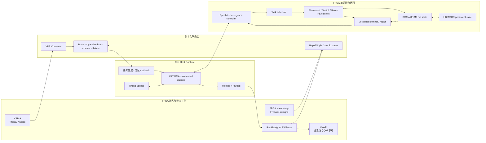
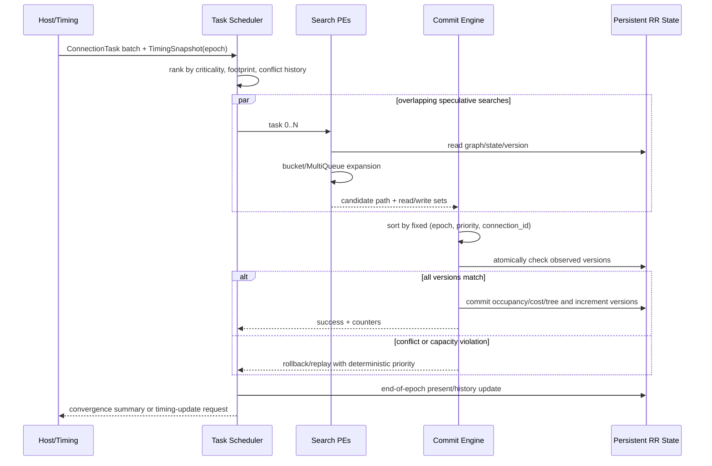
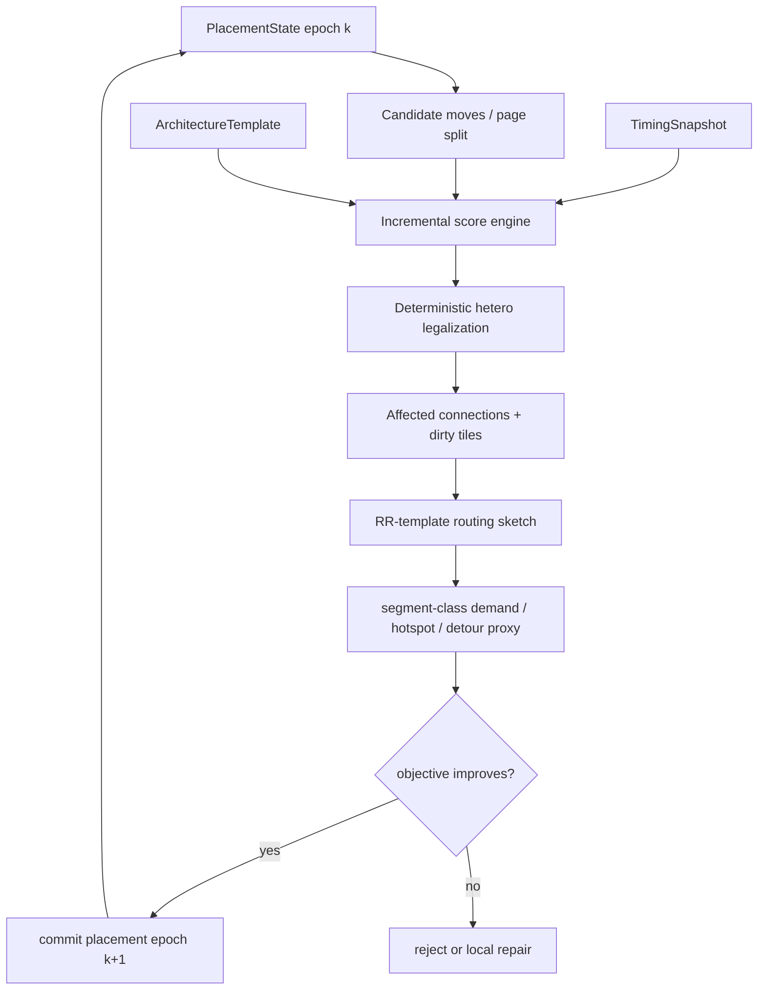
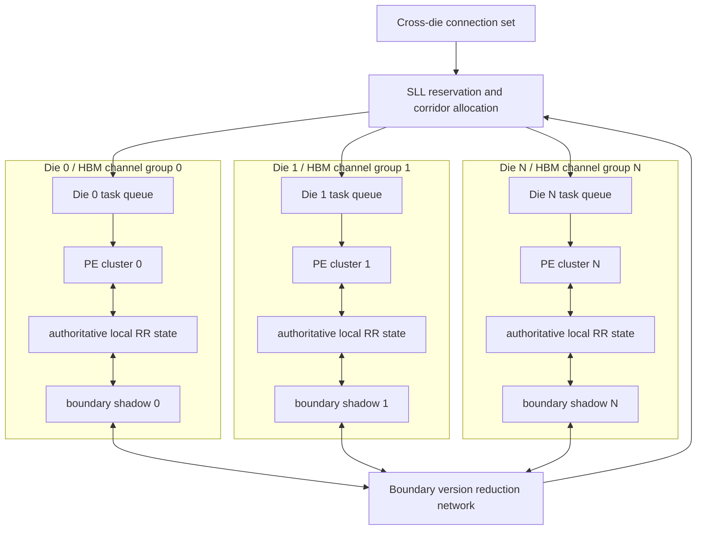
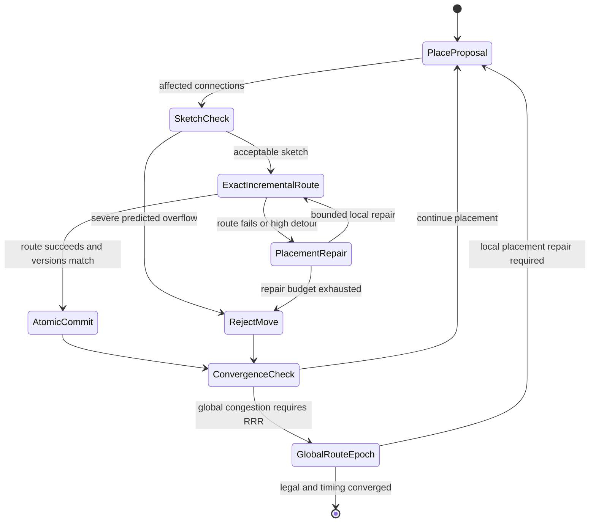
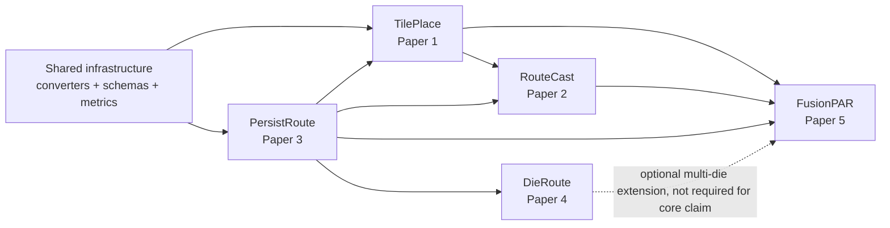

# 推荐体系结构、接口与数据流图

**定位：** 本文件把五篇研究方向落实为统一、版本化的数据面和五个独立控制面。图中的公共模块只建设一次；后续论文不得把其复用再次列为贡献。

## 1. 总体体系结构



### 责任边界

- Java 只负责商业器件图/设计导出与 RapidWright 回写；不进入板上 inner loop。
- C++ 负责 golden model、主机运行时、异常回退和 timing snapshot。
- HLS/RTL 负责正常 placement/routing 内循环、队列、状态更新和性能计数。
- Python 只负责 manifest 展开、批运行、统计和图表；不实现被测算法。
- Vivado 只作 B3 工业参考和合法性/QoR检查，不以不可见内部阶段时间作为唯一基线。

## 2. 二进制接口 v0

所有外存对象满足：little-endian、64-byte 起始地址对齐、固定宽度整数、header 带 `schema_version`、`count`、`byte_length`、SHA-256/CRC。内部主数组使用 SoA；可变长列表使用 `offset + length` 指向连续 pool。

### 2.1 `FileHeader`（64 B）

| 字段 | 位宽 | 说明 |
|---|---:|---|
| magic | 64 | `FPGAACCP` |
| schema_major / minor | 16 / 16 | 不兼容/兼容变更 |
| object_type | 32 | Architecture/Placement/Task/State/Timing/Metrics |
| element_count | 64 | 主对象数量 |
| payload_bytes | 64 | header后字节数 |
| architecture_hash | 128 | 快速匹配；完整SHA-256另存manifest |
| crc64 | 64 | payload完整性 |
| flags/reserved | 64 | endian、压缩、未来扩展；总计 512 bit |

### 2.2 `ArchitectureTemplate`

采用“模板 + 实例”二级表示：相同 tile/site 的 RR 邻接只存一次，tile instance 只记录模板 ID、坐标、clock region、die/SLR 和例外 patch。

| SoA数组 | 建议元素 | 用途 |
|---|---:|---|
| `tile_type[]` | u16 | CLB/BRAM/DSP/IO/… |
| `tile_xy[]` | 2×u16 | 物理坐标 |
| `clock_region[]`, `die_id[]` | u16 | 区域和多die |
| `template_id[]` | u16/u32 | 指向重复RR模板 |
| `node_class[]` | u16 | pin/local/segment/SLL及delay class |
| `edge_offset[]`, `edge_dst[]` | u32 | CSR邻接 |
| `edge_switch[]` | u16 | PIP/switch类 |
| `instance_patch[]` | 变长 | 禁用/例外边 |

**压缩验收：** 与未压缩 CSR 对所有 node 的邻接展开完全相同；随机抽样和全图 hash 均通过；压缩比、解码吞吐、额外延迟分别报告。

### 2.3 `PlacementState`

| 数组 | 类型 | 说明 |
|---|---|---|
| `instance_site[]` | u32 | 当前site，非法/未放置用保留值 |
| `instance_type[]` | u16 | 资源类型 |
| `macro_id[]`, `macro_offset[]` | u32/u16 | cascade/macro形状 |
| `region_mask_ref[]` | u32 | 合法region |
| `pack_cluster[]` | u32 | packing关系 |
| `place_version[]` | u32 | FusionPAR事务版本 |

### 2.4 `ConnectionTask`（固定 64 B）

| 偏移 | 字段 | 类型 | 说明 |
|---:|---|---|---|
| 0 | connection_id | u32 | 全局固定ID |
| 4 | net_id | u32 | 所属net |
| 8 | source_node | u32 | RR source |
| 12 | sink_node | u32 | RR sink |
| 16 | bbox xmin/ymin/xmax/ymax | 4×u16 | 搜索窗口 |
| 24 | criticality_q | u16 | 定点关键度 |
| 26 | delay_budget_q | u16 | 定点预算 |
| 28 | old_tree_offset | u32 | route-tree pool |
| 32 | old_tree_length | u32 | 元素数 |
| 36 | epoch | u32 | RRR/placement epoch |
| 40 | priority | u32 | 固定提交序的一部分 |
| 44 | footprint_id | u32 | 调度摘要 |
| 48 | flags | u32 | rip-up、partial、fallback等 |
| 52 | seed_or_tie | u32 | 固定tie-break，不作随机优化 |
| 56 | reserved | 64 bit | 对齐与版本扩展 |

### 2.5 `ResourceState`（建议 16 B/资源）

| 字段 | 位宽 | 说明 |
|---|---:|---|
| owner_or_list | 32 | 单owner或共享owner-list偏移 |
| occupancy | 16 | 当前占用 |
| capacity | 16 | 容量 |
| present_cost_q | 16 | 定点当前拥塞代价 |
| history_cost_q | 16 | 定点历史代价 |
| version | 32 | 每次成功写提交自增 |

delay、node class 等只读架构数据不在每迭代状态中复制。若量化溢出或 QoR 超门槛，优先扩位宽而不是隐式饱和。

### 2.6 `RouteTransaction`

```text
TransactionHeader (32 B)
  connection_id, epoch, priority, status
  read_offset/read_count
  write_offset/write_count
  path_offset/path_count

ReadSetEntry  = {resource_id:u32, observed_version:u32}
WriteSetEntry = {resource_id:u32, delta_occupancy:i16, flags:u16}
PathEntry     = {resource_id:u32}
```

可变长 pool 每个 PE 预留额度；超长路径转 overflow queue 或 host fallback，必须计数并进入 wall-clock。

### 2.7 `TimingSnapshot`

每个 connection 使用 16 B：`criticality_q:u16, flags:u16, arrival_q:i32, required_q:i32, delay_budget_q:u32`。主机按配置的 timing epoch 更新；FPGA 在两次 snapshot 间使用固定关键度，不私自改变 timing graph 语义。

### 2.8 `MetricsRecord`

原始记录使用 JSONL，每条含：run ID、design hash、stage、start/end ns、bytes、items、cycles、stall reason、conflicts、replays、fallbacks、HBM counters、power sample reference。最终 CSV 由 Python 从 JSONL 生成，不从控制台文字解析主指标。

## 3. PersistRoute 数据流



### 3.1 两级并行

- **任务级：** scheduler 不要求 bbox 无重叠；它预测冲突收益，允许低风险重叠 task 并行。
- **PE内：** 多个 bucket/queue 近似优先级，按 `cost_bin, node_id, predecessor_id` 固定 tie-break；relaxation 次序可以不同，但提交输出须确定。
- **提交级：** 单逻辑序不等于单周期串行。可按无交集 write-set 并行 validate，最终效果必须等价于固定全序。

### 3.2 确定性定义

同一 architecture/design hash、参数、fixed-point schema 和 timing snapshots 下：

1. 最终每个 connection 的 route resource sequence 一致；
2. RRR 迭代数和冲突/重放数一致；
3. 输出文件 hash 一致（允许时间戳等非语义字段归一化后比较）。

只保证 wirelength/CPD 相同不算严格确定性。

### 3.3 失败与回退

| 条件 | 板上处理 | 回退 |
|---|---|---|
| transaction pool不足 | overflow queue | 超阈值转host，计入时间 |
| 单connection搜索超预算 | 增大bbox一次 | RWRoute/VPR软件完成并回写状态 |
| 冲突率连续高于阈值 | 缩小batch/提高空间隔离 | 串行固定优先级batch |
| 定点代价溢出 | 饱和标志并中止该run | 扩位宽重构，不把饱和结果计入主表 |
| HBM channel热点 | task迁移/只读模板复制 | 降PE数并报告缩放瓶颈 |

## 4. TilePlace 与 RouteCast 数据流



TilePlace 主实验可关闭 `SKETCH`，只用 timing/异构目标；RouteCast 主实验固定 placement 外壳并比较 `SKETCH on/off`，防止两篇贡献混淆。

## 5. DieRoute 的 HBM/SLR 映射



authoritative state 永远只有一个 owner die；shadow 只保存边界容量、version、aggregate cost，不缓存可独立写的完整 owner state，从协议上避免双写。

## 6. FusionPAR 的事务状态机



原子提交检查 `place_version + resource_version + timing_epoch`。任一不匹配都不得部分更新；回滚只丢弃 candidate buffer，authoritative state 不做逆操作。

## 7. 五篇依赖关系



FusionPAR 的核心 claim 不依赖 DieRoute，否则第五篇会同时承担跨阶段和跨 die 两个变量，难以归因。DieRoute 可在扩展实验中接入。

## 8. 可参数化硬件配置

| 参数 | 初始值 | 扫描范围 | 说明 |
|---|---:|---:|---|
| `NUM_PE` | 8 | 1/2/4/8/16/32 | 受板卡和带宽约束 |
| `QUEUES_PER_PE` | 4 | 1/2/4/8 | MultiQueue消融 |
| `COST_BITS` | 16 | 12/16/20/24 | 先由软件误差界选择 |
| `HOT_WINDOW_NODES` | profiling后定 | 4K–64K | URAM/BRAM缓存 |
| `TXN_ENTRIES_PER_PE` | profiling P99 | P95/P99/max | 超长路径fallback |
| `HBM_CHANNELS` | U280可用组 | 1/2/4/8/16 | DieRoute主扫描 |
| `TIMING_EPOCH_INTERVAL` | 1 RRR | 1/2/4/8 | 精度—传输权衡 |
| `CONFLICT_THRESHOLD` | validation选定 | 0.05–0.50 | 不能在test调节 |

首个 DDR 原型只缩小 `NUM_PE`、图规模和缓存，不改变 schema/算法语义。主论文转 HBM 时不得把重新调参数后的 test 设计用于选择阈值。

## 9. 正确性断言

### Converter

- 每个 source/sink、edge、switch、tile/site、delay class 的 round-trip ID 映射可逆；
- 模板解压后的邻接 multiset 等于原图；
- 不认识的器件资源 fail closed，不静默丢弃。

### Router

- 每条 route 连续、source 到 sink 可达；
- occupancy 与所有 route tree 重新计数一致；
- 除合法共享资源外不超 capacity；
- commit 成功后涉及资源 version 恰加一；失败 transaction 不改变 authoritative state；
- 固定输入重复 5 次语义输出 hash 相同。

### Placement

- site/type/region/cascade/clock约束全部满足；
- 每个实例恰放置一次；
- 增量代价与全量重算在定点容差内一致；
- move-route 原子失败后 placement 与 routing hash 均不变。

## 10. 实现冻结点

1. **Schema freeze v0：** 先由 profiling 确定 ID/offset 位宽，再开始 RTL；不允许在 kernel 内私有改语义。
2. **Golden freeze：** C++ 事务模拟器通过 VPR/RWRoute 合法性与 QoR门槛。
3. **Cycle-model freeze：** 每类 HBM访问、queue op、commit/replay 均可计数；与单PE板上误差目标 ≤15%。
4. **Paper tag：** 每篇分别冻结软件 commit、submodule commit、bitstream hash、schema version 和 artifact manifest。
