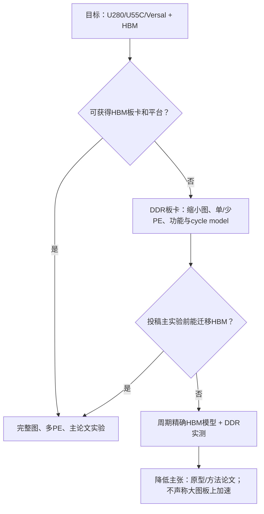

# 风险登记表、停止条件与回退方案

**原则：** 回退用于保持科学结论诚实，不用于隐藏未达到的目标。每个风险都指定早期信号、缓解、回退和对论文主张的影响。

## 1. 风险等级

- 概率/影响：高（H）、中（M）、低（L）。
- 优先级：`P0 = 可能否定论文主张`；`P1 = 可能显著延期或降级实验`；`P2 = 可局部绕过`。
- 风险状态写入每篇实验 manifest 对应的 issue；关闭风险必须附日志或数据。

## 2. 共性风险

| ID | 优先级 | 风险 | 概率/影响 | 早期信号 | 首选缓解 | 回退 | 对主张的影响 |
|---|---|---|---|---|---|---|---|
| C01 | P0 | 最近论文已覆盖核心机制 | M/H | Potter、FPGA 2026、DiffRouter、RouterAcc全文出现相同协议 | 每季度/截稿前30天检索并做claim chart | 改问题定义或做正面对比；无法区分则停止该篇 | 不允许仅改名继续 |
| C02 | P0 | 五篇实为系统切片 | M/H | 后篇主结果可由前篇加开关直接产生 | 每篇冻结独立输入、伪代码、硬件和主表 | 合并论文或取消一篇 | 保持组合研究诚信 |
| C03 | P0 | 端到端加速被PCIe/预处理吞噬 | H/H | kernel快但offload efficiency低、总加速<1.5× | 状态常驻、批量命令、模板缓存、服务模式 | 降低offload边界；转CPU/GPU协同或只投体系结构研究 | 不得用kernel speedup替代 |
| C04 | P0 | QoR/合法率以速度换取 | M/H | CPD/WL>2%、失败集中于大设计 | 先修golden算法、增加定点位宽/回退 | 放宽到预声明5%档并降低主张；仍失败则停止 | 不能删除失败设计 |
| C05 | P1 | baseline不可复现 | H/M | 代码缺失、依赖腐化、论文配置不全 | B0/B1/B2分级、提前构建 | 可信重实现并标注，或只引用公开结果 | 不声称直接speedup |
| C06 | P1 | Vivado/许可证/contest版本不可用 | M/H | 无Enterprise、Tcl检查不通过 | 提前确认license server和固定VM | 以RapidWright合法性+可用Vivado样本补充 | 工业验证范围缩小须明示 |
| C07 | P1 | 工具版本漂移 | M/M | 同设计QoR随版本变化 | 容器/系统镜像、commit、2022.2主环境、contest独立环境 | 报告port与strict reproduction两套 | 不跨版本混算speedup |
| C08 | P1 | benchmark泄漏/手工优化 | M/H | 调参设计与测试同族 | family-level split、冻结config hash | leave-one-family-out重做 | 原主结果作开发集，不得投稿 |
| C09 | P1 | 只有合成压力测试支持结论 | M/H | 真实设计收益消失 | 主表优先公开真实设计 | 降为机制/短文或停止 | 不外推产业价值 |
| C10 | P2 | 原始日志/元数据丢失 | M/M | 表格数字无法追溯run_id | append-only raw、自动manifest/hash | 重跑全部相关实验 | 不允许手工补数字 |

## 3. PersistRoute 风险

| ID | 优先级 | 风险 | 早期信号 | 缓解 | 回退/停止条件 |
|---|---|---|---|---|---|
| PR01 | P0 | UltraScale+ RR图超出HBM/DDR或带宽 | 单connection扩展大量随机读；HBM利用低但PE stall高 | tile模板压缩、只读复制、热点窗口、edge重排 | DDR先跑缩小图；主论文前必须HBM大图，否则缩为FCCM/FPL原型 |
| PR02 | P0 | 投机冲突/重放抵消并行收益 | 高拥塞设计rollback>30%、长尾queue | footprint+历史冲突调度、动态batch、预留关键资源 | 高冲突退化为隔离批；若多数真实设计如此，取消“冲突容忍带来性能”claim |
| PR03 | P0 | 确定提交成为串行瓶颈 | commit stall>25%、search PE空闲 | disjoint write-set并行validate、分bank commit、固定全序等价 | 改成分区内确定+全局barrier；若不能严格确定，降低确定性主张 |
| PR04 | P0 | 定点代价改变路径/QoR | 软件fixed vs float超过2%或迭代不收敛 | profiling决定动态范围、分字段量化、形式/差分测试 | 扩位宽/部分浮点；不得保留饱和配置 |
| PR05 | P1 | route tree/transaction长尾溢出 | P99与max差异巨大 | chunked pool、overflow buffer、高扇出专用任务 | 高扇出由host/RWRoute fallback，计入时间；fallback过高则专门设计模块 |
| PR06 | P1 | timing snapshot过旧 | critical net反复reroute、CPD恶化 | 自适应请求timing update、关键net短epoch | 每RRR host更新；若传输吞噬收益，缩小timing claim |
| PR07 | P1 | CUFR/Potter强基线使3×不足 | 强多核已接近内存上限 | 对等优化host、突出能效/确定性/扩展性 | 达不到3×则不主投DAC，转FPGA/FCCM且如实报告 |

## 4. TilePlace 风险

| ID | 优先级 | 风险 | 早期信号 | 缓解 | 回退/停止条件 |
|---|---|---|---|---|---|
| TP01 | P0 | 与FPGA 2026页布局贡献重合 | 全文显示已含异构/timing/legalization | 取得全文后逐项表；改为新时序/异构协议 | 只有功能扩展则并入FusionPAR或停止独立投稿 |
| TP02 | P0 | page目标与routed CPD弱相关 | placement proxy改善但CPD不变/恶化 | delay-class/criticality增量反馈、用真实router验证 | timing消融无效则不能以timing为主claim |
| TP03 | P0 | 异构stitching破坏全局质量 | boundary附近BRAM/DSP拥塞、合法化移动大 | 形状/配额预留、边界代价、跨页repair | 退化>5%则缩小适用范围；仍不稳定则转专用阵列场景 |
| TP04 | P1 | CPU/GPU布局已足够快 | 总时间由routing主导、placement占比低 | 选择交互/增量场景并证明系统价值 | 不夸大全流加速；可转实时/增量placement方向 |
| TP05 | P1 | 大页面PE资源/Fmax不可扩 | 资源随候选位置爆炸 | 分时复用、hierarchical pages、稀疏候选 | 若失去毫秒级优势，聚焦QoR/能效而非绝对延迟 |

## 5. RouteCast 风险

| ID | 优先级 | 风险 | 早期信号 | 缓解 | 回退/停止条件 |
|---|---|---|---|---|---|
| RC01 | P0 | sketch与精确拥塞相关性低 | held-out Spearman接近0、热点错位 | 增加segment/switch/pin/local资源语义，校准但不泄漏 | 未见家族仍无稳定相关，停止独立方向 |
| RC02 | P0 | 相关但不改善最终P&R | estimator好、placer不会响应或振荡 | 设计有界反馈、滞后/信赖域、较低频率 | 相对no-sketch总时间/QoR无净益则不投稿 |
| RC03 | P0 | 反馈成本超过节省 | sketch占布局时间>20%且少量减少RRR | affected connection/dirty tile增量、与placement重叠 | 退为离线预测工具，不声称闭环加速 |
| RC04 | P1 | 近似忽略高扇出/clock等特殊net | 特殊net主导误差 | 按net class单独摘要或排除并说明 | 适用范围明确；不能静默过滤 |
| RC05 | P1 | 与ASIC拥塞估计差异不充分 | 去掉FPGA资源类后结果相同 | 做semantic ablation | 若差异不显著，无法支撑FPGA专用主张 |

## 6. DieRoute 风险

| ID | 优先级 | 风险 | 早期信号 | 缓解 | 回退/停止条件 |
|---|---|---|---|---|---|
| DR01 | P0 | 无公开真实多die设计 | 仅小型合成网格 | 提前联系数据来源、VTR公开模型、可发布生成流程 | 无可信真实主表则不主投DAC |
| DR02 | P0 | SLL预留导致局部绕路/失败 | 跨die好但die内overflow上升 | 联合预算、可回收reserve、criticality-aware修正 | QoR/失败不劣门槛未过则停止 |
| DR03 | P0 | HBM分区负载严重不均 | 单channel饱和、其余空闲 | task迁移、只读模板复制、容量加权partition | 仅展示最佳人工映射不合格 |
| DR04 | P1 | shadow state过旧导致冲突 | boundary replay高、version失配 | 自适应同步、aggregate reservation | 退为barrier同步并量化损失；无优势则缩小claim |
| DR05 | P1 | 拓扑参数化只是配置开关 | 不同拓扑使用同一greedy | 抽象boundary graph并给拓扑独立算法 | 没有跨拓扑机制则只声明目标器件 |

## 7. FusionPAR 风险

| ID | 优先级 | 风险 | 早期信号 | 缓解 | 回退/停止条件 |
|---|---|---|---|---|---|
| FP01 | P0 | 收益完全来自前四篇相加 | shared/interleaved消融≈0 | 强制与最佳顺序组合比较 | 无独立净益则取消第五篇 |
| FP02 | P0 | placement-routing反馈振荡 | move→route fail→repair反复 | trust region、hysteresis、progress potential | 无收敛证明/实证则转为有界局部ECO场景 |
| FP03 | P0 | 原子move-route事务过大 | read/write set巨大、abort高 | connection局部化、两阶段validation、预算 | 大多数move无法局部提交则缩小move集合或停止 |
| FP04 | P1 | timing状态跨阶段不一致 | placement预测与route timing分叉 | 单一TimingSnapshot版本、barrier更新 | 退为较低频交错；如同顺序流则无新意 |
| FP05 | P1 | end-to-end验证极其昂贵 | Vivado检查主导、迭代周期慢 | RapidWright快速检查+抽样Vivado终检 | 保持外部验证单列，不删减QoR检查 |

## 8. 硬件与资源回退树

DDR fallback 必须与 HBM 使用相同 schema、事务和算法。不得为获得数字而另写一个只适用于小图的“论文版”kernel。

## 9. 研究方向停止/转向规则

### 停止当前论文题目

满足任一条件：

- 最近同行工作已经覆盖同一问题、算法和硬件机制，且无法做强基线上的实质扩展；
- 核心机制在 family-held-out 数据上无效；
- 为达到速度必须超过预声明 QoR/失败门槛；
- 主要结果可由前一篇系统直接产生；
- 只有 kernel 或合成小图证据，端到端/真实设计没有改善。

### 可转向而不违背研究边界

| 原方向失败原因 | 合理转向 | 仍需保留的约束 |
|---|---|---|
| PersistRoute冲突过高 | 毫秒级增量/ECO或partial routing | 仍使用FPGA routing语义、完整增量wall-clock |
| TilePlace通用QoR不足 | 特定规则加速器/硬块布局 | 明确适用范围，不外推通用placer |
| RouteCast闭环无净益 | routing difficulty predictor/编译资源分配 | 预测目标与最终精确route一致验证 |
| DieRoute缺真实数据 | 多die architecture exploration协加速 | 不主张商业部署；公开生成器 |
| FusionPAR振荡 | 有界局部placement repair + incremental routing | 与顺序ECO强基线比较 |

## 10. 投稿前风险审查

- [ ] 最近两年正式论文、accepted papers、arXiv已重新检索；
- [ ] 所有最接近工作已获取全文，未获取者明确 B2；
- [ ] 所有目标门槛在 test split 上通过，失败设计仍在表中；
- [ ] ASIC工作只出现在加速机制段，没有被写成FPGA算法依据；
- [ ] CPU/GPU/FPGA在相同QoR和相同输入上比较；
- [ ] 端到端与kernel数字均有，摘要用端到端；
- [ ] HBM/DDR、cold/steady-state、公开/商业数据分别标注；
- [ ] 后篇复用模块已引用前作并从贡献列表移除；
- [ ] 代码、bitstream、manifest、raw log和主图均由冻结tag重建；
- [ ] 负结果和局限已写入论文，不靠选择性报告规避。
